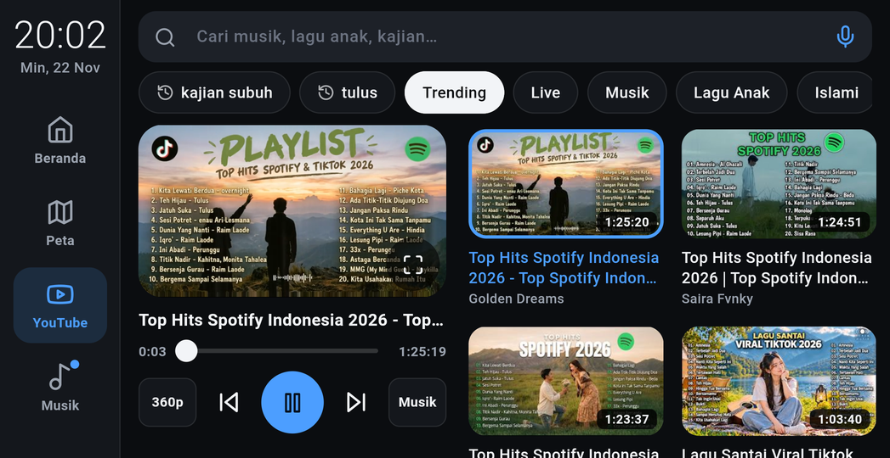
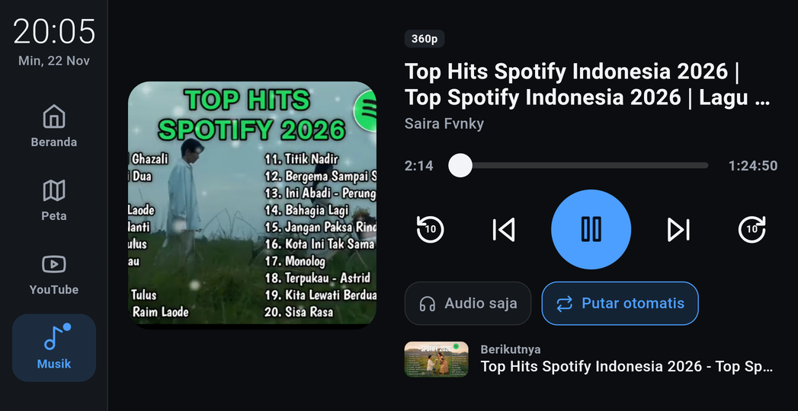

<p align="center"></p>

<h1 align="center">Kemudi</h1>

<p align="center">
Turns an Android phone on the dashboard into a car head unit:<br>
YouTube without ads, music, steering-wheel buttons and turn-by-turn navigation.
</p>

*Kemudi* is Indonesian for the steering wheel. The app's screens and voice prompts are in
Indonesian. Kemudi is an independent open-source project and is not affiliated with,
endorsed or sponsored by YouTube or Google.

<p align="center">
  
  
</p>

## Features

- **Beranda** (home): a dashboard with the clock, a dark map following the car, what is
  playing with big controls, and quick actions (Trending, Live, Cari, Navigasi).
- **YouTube:** search by typing or by voice, your last three searches one tap away,
  categories, Live and an endless grid. Videos play without ads, with SponsorBlock skipping
  sponsor, intro, outro, self-promotion and non-music segments. 360p, 480p and 720p (HLS,
  where YouTube offers it) or Audio Only. Picture-in-picture over other apps, playback in the
  background and with the screen off, autoplay (Putar otomatis), 10-second jumps, and resume
  where you left off.
- **Musik:** large artwork and controls, swipe left or right to skip, Audio Only (Audio
  saja).
- **Steering-wheel and Bluetooth buttons:** play, pause, next, previous and seek through the
  phone's media session, also from the notification and the lock screen.
- **Peta** (maps and navigation): a dark map with readable roads, place search as you type
  or by voice (nearby first), route preview with alternatives and toll markers, Indonesian
  voice prompts, automatic rerouting, guidance that keeps running in the background, and a
  hand-off to Google Maps.
- **Made for the road:** playback and the video grid recover by themselves after a network
  drop (tunnels), errors are kept in a log on the phone, and it stays smooth on mid-range
  phones (developed on a Samsung Galaxy A6+ with Android 10).

## Install

1. Open the [latest release](https://github.com/RulyOctareza/kemudi/releases/latest) on the
   phone and download one APK:
   - `kemudi-<version>-arm64-v8a.apk` for most phones;
   - `kemudi-<version>-armeabi-v7a.apk` for 32-bit phones such as the Galaxy A6+. If the
     arm64 APK does not install ("App not installed"), the phone is 32-bit; take this one.
2. Open the file and allow your browser or file manager to install apps when Android asks.
3. Open Kemudi. It asks for location only when you tap **Izinkan lokasi**.

Kemudi needs Android 7.0 or newer; picture-in-picture needs Android 8.0. For Indonesian voice
prompts, install Google's Speech Services (Google TTS) with the Indonesian voice.

**Android developer verification.** Since 30 September 2026 Android requires apps on
certified devices in Brazil, Indonesia, Singapore and Thailand to come from a developer
registered with Google, and this extends worldwide in 2027. Kemudi is not registered. If
Android refuses to install it, use Android's flow for installing unverified apps, or install
from a computer with `adb install kemudi-<version>-<abi>.apk`.

## Updates

- With [Obtainium](https://github.com/ImranR98/Obtainium): add
  `https://github.com/RulyOctareza/kemudi` and it installs the right APK and tells you about
  new releases.
- By hand: install the new APK over the old one. Settings, the resume point and recent
  destinations are kept, because every release is signed with the same key. Keep to the same
  APK type (arm64-v8a or armeabi-v7a); switching from arm64-v8a to armeabi-v7a needs an
  uninstall first.

## Verify a download

Every release lists the SHA-256 checksum of each APK (`SHA256SUMS.txt`). Every Kemudi APK is
signed with the same certificate, `CN=Kemudi, O=Personal, C=ID`, whose SHA-256 fingerprint
is:

```
9f918c6fd69f601171c3d0b59514630814f201936dff1e00b110e87132d0660c
```

To compare on a computer:

```sh
sha256sum -c SHA256SUMS.txt
apksigner verify --print-certs kemudi-<version>-<abi>.apk   # "CN=Kemudi" and the fingerprint
```

## Permissions and privacy

- **Location**, asked when you tap **Izinkan lokasi**: the car on the map and navigation. It
  is used in the background only while guidance runs, shown by the "Navigasi aktif"
  notification.
- **Notifications and foreground services**: media controls, playback in the background and
  guidance.
- **Internet**.

No account, no analytics, no ads, no tracking. Errors are written to a file on the phone and
never sent anywhere. The app talks only to these services:

| Service | For | Notes |
|---|---|---|
| YouTube | search and video streams | Unofficial: no API key, through [youtube_explode_dart](https://github.com/Hexer10/youtube_explode_dart). |
| [SponsorBlock](https://sponsor.ajay.app) | segments to skip | Community data under CC BY-NC-SA 4.0. |
| [OpenStreetMap](https://www.openstreetmap.org/copyright) tiles | the map | Data © OpenStreetMap contributors, ODbL. |
| [OSRM](https://project-osrm.org) public servers (project-osrm.org, FOSSGIS) | routes | Fair use, non-commercial. |
| [Photon](https://photon.komoot.io) by komoot | place search | Fair use. |
| Mapbox Directions | live traffic routes | Only in builds made with your own token. |

## Drive safely

Kemudi is meant for a phone mounted as the car's display. Choose what to play and where to go
before you drive, and keep your eyes on the road. Watching video while driving is dangerous
and illegal in many places; while moving, use Audio Only, the map and the steering-wheel
buttons. Follow your local traffic laws. You use Kemudi at your own risk.

## Known limits

- Streams break whenever YouTube changes its player; a newer Kemudi release with an updated
  youtube_explode_dart is the fix.
- YouTube rate-limits bursts of searches from one network (common on mobile carriers); the
  app says so, and a search a little later works.
- HD needs YouTube to offer an HLS stream for the video; otherwise 360p plays and the app says
  so.
- Release builds route with the public OSRM servers: no live traffic, and avoiding tolls is
  available only with Mapbox. These servers and the OpenStreetMap tiles are shared community
  resources under fair use and may throttle or refuse requests.
- The interface and voice prompts are Indonesian only.
- It is developed and tested on one phone (Galaxy A6+, Android 10). Other phones should work
  but have not been tested; bug reports are welcome.

## Build from source

You need Flutter 3.35 (CI uses 3.35.2) and the Android SDK.

```sh
flutter pub get
flutter run                 # debug build on the connected phone
flutter test && flutter analyze
flutter build apk --release --split-per-abi --target-platform android-arm,android-arm64
```

- **Mapbox (optional):** put `{"MAPBOX_TOKEN": "pk..."}` in `mapbox.local.json` at the
  repository root (gitignored) and add `--dart-define-from-file=mapbox.local.json` to the
  run or build command. Routes then use Mapbox with live traffic, and OSRM stays the
  fallback. Do not share an APK built with your token: it can be extracted, and the usage is
  billed to you.
- **Signing:** without `android/key.properties` a release build is signed with your debug
  key. Such an APK cannot be installed over a Kemudi from the releases page; uninstall that
  one first.

Architecture, debugging builds, measuring smoothness and the release process are described in
[CONTRIBUTING.md](CONTRIBUTING.md).

## License

Kemudi is free software: you can redistribute it and/or modify it under the terms of the GNU
General Public License as published by the Free Software Foundation, either version 3 of the
License, or (at your option) any later version. See [LICENSE](LICENSE).

"YouTube" is a trademark of Google LLC; Kemudi uses the name only to say where videos come
from.

### Third-party notices

The Indonesian instruction text for OSRM routes (`lib/services/route_instructions.dart`)
is ported from [osrm-text-instructions](https://github.com/Project-OSRM/osrm-text-instructions):

```
Copyright (c) 2016, Project OSRM contributors
All rights reserved.

Redistribution and use in source and binary forms, with or without modification,
are permitted provided that the following conditions are met:

Redistributions of source code must retain the above copyright notice, this list
of conditions and the following disclaimer.
Redistributions in binary form must reproduce the above copyright notice, this
list of conditions and the following disclaimer in the documentation and/or
other materials provided with the distribution.

THIS SOFTWARE IS PROVIDED BY THE COPYRIGHT HOLDERS AND CONTRIBUTORS "AS IS" AND
ANY EXPRESS OR IMPLIED WARRANTIES, INCLUDING, BUT NOT LIMITED TO, THE IMPLIED
WARRANTIES OF MERCHANTABILITY AND FITNESS FOR A PARTICULAR PURPOSE ARE
DISCLAIMED. IN NO EVENT SHALL THE COPYRIGHT HOLDER OR CONTRIBUTORS BE LIABLE FOR
ANY DIRECT, INDIRECT, INCIDENTAL, SPECIAL, EXEMPLARY, OR CONSEQUENTIAL DAMAGES
(INCLUDING, BUT NOT LIMITED TO, PROCUREMENT OF SUBSTITUTE GOODS OR SERVICES;
LOSS OF USE, DATA, OR PROFITS; OR BUSINESS INTERRUPTION) HOWEVER CAUSED AND ON
ANY THEORY OF LIABILITY, WHETHER IN CONTRACT, STRICT LIABILITY, OR TORT
(INCLUDING NEGLIGENCE OR OTHERWISE) ARISING IN ANY WAY OUT OF THE USE OF THIS
SOFTWARE, EVEN IF ADVISED OF THE POSSIBILITY OF SUCH DAMAGE.
```

Map data © OpenStreetMap contributors (ODbL); routes by OSRM or Mapbox; search by Photon
(komoot); skip segments by SponsorBlock (CC BY-NC-SA 4.0). The app shows the map credits on
the map. The Flutter packages Kemudi uses keep their own licenses (BSD, MIT and Apache 2.0),
all compatible with the GPL.

## Ringkasan (Bahasa Indonesia)

Kemudi mengubah HP di dasbor mobil menjadi head unit: YouTube tanpa iklan dengan
SponsorBlock, Audio Only, picture-in-picture, tombol setir/Bluetooth, dan navigasi belokan
demi belokan dengan suara bahasa Indonesia.

- **Pasang:** unduh APK dari [rilis terbaru](https://github.com/RulyOctareza/kemudi/releases/latest):
  `arm64-v8a` untuk kebanyakan HP, `armeabi-v7a` untuk HP 32-bit (mis. Galaxy A6+). Jika
  Android menolak memasang (verifikasi developer Android berlaku di Indonesia sejak 30
  September 2026), pakai alur pemasangan aplikasi tak terverifikasi di Android atau
  `adb install`.
- **Update:** pakai [Obtainium](https://github.com/ImranR98/Obtainium) dengan alamat repo
  ini, atau pasang APK baru di atas yang lama; pengaturan tetap tersimpan.
- **Keselamatan:** atur tujuan dan tontonan sebelum berangkat; saat berkendara pakai Audio
  Only dan peta. Patuhi aturan lalu lintas.
- Laporkan masalah lewat [Issues](https://github.com/RulyOctareza/kemudi/issues).
